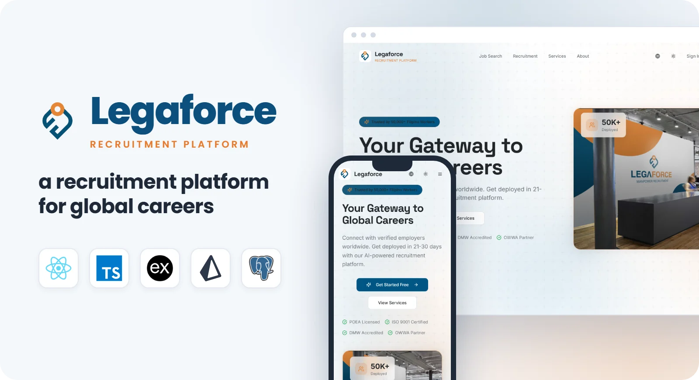

<p align="center">
  
</p>

##

<p align="center">
  
  
  
  
  
  
  
  
</p>

<h1 align="center">🧳 Legaforce</h1>

<p align="center">
  <b>Legaforce</b> is a recruitment platform for an overseas hiring agency, built with <b>React</b>, <b>TypeScript</b> and an <b>Express + Prisma</b> API on <b>PostgreSQL</b>.<br/>
  Applicants, employers and admins each get their own portal, covering the whole journey from application to deployment.
</p>

---

## ✨ Features

- 👤 **Applicant portal**: profile and CV builder, document uploads, job search, saved jobs, applications and status reports
- 🏢 **Employer portal**: company profile, job orders, candidate shortlists, interviews, deployments, invoices and reports
- 🛠️ **Admin portal**: applicant and employer verification, job orders, applications, deployments, complaints, invoices, compliance and system health
- 🤖 **AI with Gemini**: CV summaries generated from the applicant's profile and match scores between candidates and job requirements (with a local fallback when no key is set)
- 🔔 **Real-time notifications** over Server-Sent Events, with per-user preferences and email delivery
- 🔒 **Security**: JWT auth with role-based access, Zod validation, Helmet, and Arcjet rate limiting and bot protection
- 📜 **Audit log** of admin actions, plus SLA tracking on applications and complaints
- 🌐 Responsive UI with **Tailwind CSS** + **shadcn/ui**, and English / Arabic translations

---

## 🗂 Project Structure

```
client/    React 18 + TypeScript + Vite + TanStack Query + Zustand
server/    Express 5 API: routes, controllers, services, Prisma schema and seed
```

The API exposes 100+ REST endpoints under `/api/v1` (`auth`, `applicant`, `employer`, `admin`, `notifications`).

---

## 🌐 Demo

🔗 **Live Demo**: [Legaforce](https://legaforce.vercel.app)

---

## ⚡ Quick Start

Follow these steps to get a local copy of the project up and running.

### 1️⃣ Clone the repository

```bash
git clone https://github.com/Renz-Eryll/Legaforce.git
cd Legaforce
```

### 2️⃣ Set up the API

Create `server/.env.development.local`:

```env
DATABASE_URL=your_postgres_url
JWT_SECRET=your_jwt_secret
FRONTEND_URL=http://localhost:5173
GEMINI_API_KEY=your_gemini_key        # optional
ARCJET_KEY=your_arcjet_key            # optional
SENDGRID_API_KEY=your_sendgrid_key    # optional
```

```bash
cd server
npm install
npm run prisma:push
npm run prisma:seed
npm run dev
```

### 3️⃣ Start the client

Create `client/.env` with `VITE_API_URL=http://localhost:5000/api/v1`, then:

```bash
cd client
npm install
npm run dev
```

Open **http://localhost:5173** in your browser to view Legaforce.

---

## 📧 Contact

- **Name**: Renz Eryll Ramelo
- **LinkedIn**: [www.linkedin.com/in/renz-eryll-ramelo](https://www.linkedin.com/in/renz-eryll-ramelo)
- **GitHub**: [https://github.com/Renz-Eryll](https://github.com/Renz-Eryll)
